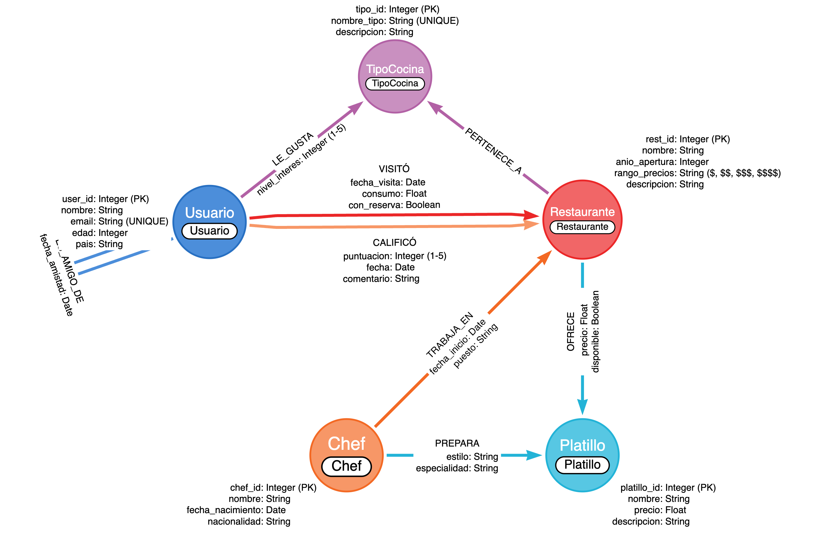
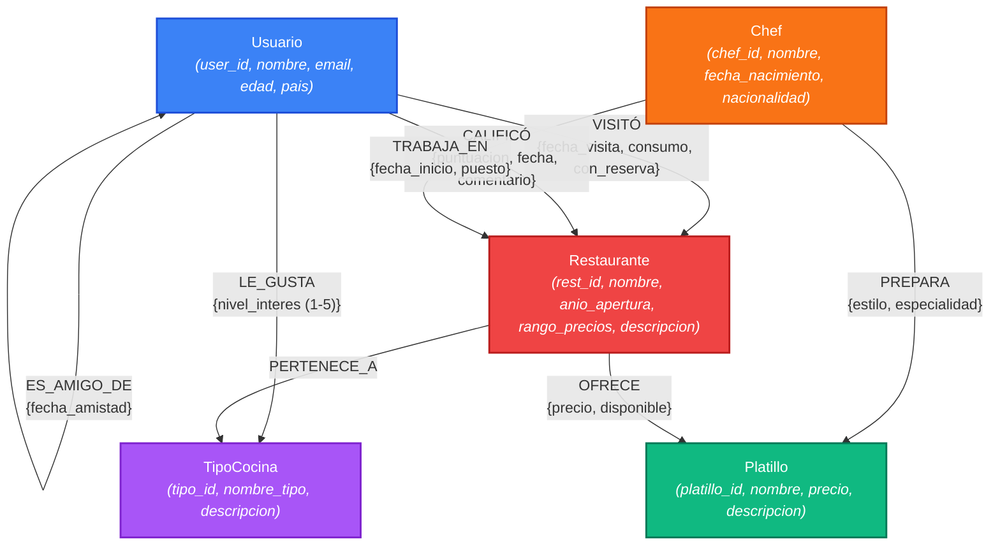

# Documentación Técnica — Sistema de Recomendación de Restaurantes con Neo4j

**Proyecto 2 — Sistemas de Bases de Datos 2**  
**Universidad de San Carlos de Guatemala — Facultad de Ingeniería**  
**Carnet:** 202300353  
**Semestre:** 2do Semestre 2026

---

## Índice

1. [Modelo Conceptual de Grafos](#1-modelo-conceptual-de-grafos)
2. [Descripción de Nodos y Propiedades](#2-descripción-de-nodos-y-propiedades)
3. [Descripción de Relaciones y Propiedades](#3-descripción-de-relaciones-y-propiedades)
4. [Reglas de Negocio Implementadas](#4-reglas-de-negocio-implementadas)
5. [Script de Creación del Esquema](#5-script-de-creación-del-esquema)
6. [Proceso de Carga de Datos](#6-proceso-de-carga-de-datos)
7. [Consultas de Negocio Implementadas](#7-consultas-de-negocio-implementadas)
8. [Análisis de Redes](#8-análisis-de-redes)
9. [Ventajas de usar Neo4j para este Problema](#9-ventajas-de-usar-neo4j-para-este-problema)

---

## 1. Modelo Conceptual de Grafos

### Diagrama Oficial del Modelo (Diseñado en Arrows.app)



> [!NOTE]
> **Diagrama Oficial elaborado en Arrows.app:** El modelo conceptual de grafos fue elaborado utilizando la herramienta especializada recomendada por Neo4j [arrows.app](https://arrows.app/). Se proveen múltiples formatos para máxima portabilidad:
> - 📄 **Archivo vectorial SVG oficial:** [`modelo_grafos.svg`](./modelo_grafos.svg) / [`Untitled graph.svg`](./Untitled%20graph.svg)
> - 🖼️ **Renderizado en alta definición PNG (2.7K):** [`modelo_grafos.png`](./modelo_grafos.png)
> - 🛠️ **Esquema de modelado JSON:** [`modelo_grafos_arrows.json`](./modelo_grafos_arrows.json) (importable en arrows.app para edición)

### Diagrama Mermaid (Renderizado Nativo en Markdown)



### Diagrama Estructurado ASCII

```
                    ┌─────────────┐
                    │  TipoCocina │
                    │─────────────│
                    │ tipo_id     │
                    │ nombre_tipo │
                    │ descripcion │
                    └──────┬──────┘
                           │
              LE_GUSTA     │    PERTENECE_A
         ┌─────────────────┤◄──────────────────┐
         │  {nivel_interes} │                   │
         │                  │                   │
   ┌─────┴─────┐     ┌─────┴──────┐     ┌──────┴──────┐
   │  Usuario   │     │Restaurante │     │   Platillo  │
   │────────────│     │────────────│     │─────────────│
   │ user_id    │     │ rest_id    │     │ platillo_id │
   │ nombre     │     │ nombre     │     │ nombre      │
   │ email      │     │ anio_apert │     │ precio      │
   │ edad       │     │ rango_prec │     │ descripcion │
   │ pais       │     │ descripcion│     └──────┬──────┘
   └──┬──┬──────┘     └──┬──┬──────┘            │
      │  │                │  │                   │
      │  │  CALIFICÓ      │  │ OFRECE            │ PREPARA
      │  │ {puntuacion,   │  │ {precio,          │ {estilo,
      │  │  fecha,        │  │  disponible}      │  especialidad}
      │  │  comentario}   │  │                   │
      │  └────────────────┘  │            ┌──────┴──────┐
      │                      │            │    Chef     │
      │  VISITÓ              │            │─────────────│
      │ {fecha_visita,       │            │ chef_id     │
      │  consumo,            │ TRABAJA_EN │ nombre      │
      │  con_reserva}        │◄───────────│ fecha_nac   │
      └──────────────────────┘ {fecha_ini,│ nacionalidad│
                                 puesto}  └─────────────┘
      
      Usuario ←──ES_AMIGO_DE──→ Usuario
                {fecha_amistad}
```

### Justificación del Modelo de Grafos

Se eligió un modelo de grafos por las siguientes razones:

1. **Relaciones como ciudadanos de primera clase:** En un modelo relacional, las relaciones entre usuarios, restaurantes y chefs requerirían múltiples tablas intermedias (tablas de unión). En Neo4j, las relaciones son entidades propias con propiedades, lo que simplifica el diseño.

2. **Consultas de traversal eficientes:** Las recomendaciones basadas en amigos de amigos (hasta 3 grados de separación) requieren self-joins recursivos en SQL, que son costosos y complejos. En Cypher, esto es un patrón natural: `[:ES_AMIGO_DE*1..3]`.

3. **Modelado intuitivo:** El dominio del problema (red social + restaurantes + preferencias) es inherentemente un grafo de relaciones. El modelo visual se mapea directamente a la implementación.

---

## 2. Descripción de Nodos y Propiedades

### 2.1 Usuario
Personas que utilizan la plataforma de recomendación.

| Propiedad | Tipo | Descripción | Ejemplo |
|-----------|------|-------------|---------|
| `user_id` | Integer | Identificador único del usuario | `1` |
| `nombre` | String | Nombre completo | `"María García López"` |
| `email` | String | Correo electrónico único | `"maria.garcia@correo.com"` |
| `edad` | Integer | Edad en años (18-65) | `28` |
| `pais` | String | País de residencia | `"Guatemala"` |

### 2.2 Restaurante
Establecimientos gastronómicos disponibles en la plataforma.

| Propiedad | Tipo | Descripción | Ejemplo |
|-----------|------|-------------|---------|
| `rest_id` | Integer | Identificador único del restaurante | `1` |
| `nombre` | String | Nombre del establecimiento | `"La Casa de Luna"` |
| `anio_apertura` | Integer | Año de inauguración | `2015` |
| `rango_precios` | String | Categoría de precios (`$`, `$$`, `$$$`, `$$$$`) | `"$$"` |
| `descripcion` | String | Descripción breve | `"Restaurante de cocina selecta"` |

**Significado de los rangos de precios:**
| Rango | Consumo esperado (Q) | Descripción |
|-------|---------------------|-------------|
| `$` | 50 - 150 | Económico |
| `$$` | 150 - 350 | Moderado |
| `$$$` | 350 - 600 | Alto |
| `$$$$` | 600 - 1,200 | Premium |

### 2.3 TipoCocina
Categorías gastronómicas para clasificar restaurantes.

| Propiedad | Tipo | Descripción | Ejemplo |
|-----------|------|-------------|---------|
| `tipo_id` | Integer | Identificador único | `1` |
| `nombre_tipo` | String | Nombre de la categoría | `"Mexicana"` |
| `descripcion` | String | Descripción de la tradición culinaria | `"Cocina tradicional mexicana..."` |

**Tipos de cocina disponibles (20):** Mexicana, Italiana, Japonesa, China, Francesa, Tailandesa, India, Peruana, Española, Americana, Coreana, Mediterránea, Árabe, Brasileña, Vietnamita, Griega, Turca, Colombiana, Guatemalteca, Fusión.

### 2.4 Chef
Personas que lideran la preparación culinaria.

| Propiedad | Tipo | Descripción | Ejemplo |
|-----------|------|-------------|---------|
| `chef_id` | Integer | Identificador único | `1` |
| `nombre` | String | Nombre completo | `"Carlos Martínez"` |
| `fecha_nacimiento` | Date | Fecha de nacimiento | `1985-03-15` |
| `nacionalidad` | String | País de origen | `"Perú"` |

### 2.5 Platillo
Preparaciones culinarias ofrecidas por los restaurantes.

| Propiedad | Tipo | Descripción | Ejemplo |
|-----------|------|-------------|---------|
| `platillo_id` | Integer | Identificador único | `1` |
| `nombre` | String | Nombre del platillo | `"Tacos al Pastor"` |
| `precio` | Float | Precio base de referencia | `85.50` |
| `descripcion` | String | Descripción del platillo | `"Delicioso tacos al pastor..."` |

---

## 3. Descripción de Relaciones y Propiedades

### 3.1 CALIFICÓ
`(Usuario)-[:CALIFICÓ]->(Restaurante)`

Un usuario califica un restaurante después de visitarlo.

| Propiedad | Tipo | Descripción | Rango/Ejemplo |
|-----------|------|-------------|---------------|
| `puntuacion` | Integer | Calificación en estrellas | 1-5 |
| `fecha` | Date | Fecha de la calificación | `2024-03-15` |
| `comentario` | String | Opinión del usuario | `"Excelente comida"` |

**Cardinalidad:** Un usuario puede calificar múltiples restaurantes. Un usuario NO puede calificar el mismo restaurante más de una vez.

### 3.2 VISITÓ
`(Usuario)-[:VISITÓ]->(Restaurante)`

Registro de visitas de usuarios a restaurantes.

| Propiedad | Tipo | Descripción | Rango/Ejemplo |
|-----------|------|-------------|---------------|
| `fecha_visita` | Date | Fecha de la visita | `2024-06-20` |
| `consumo` | Float | Monto total gastado | `245.80` |
| `con_reserva` | Boolean | Si la visita fue con reserva previa | `true` / `false` |

**Cardinalidad:** Un usuario puede visitar el mismo restaurante múltiples veces (cada visita genera una relación separada).

### 3.3 ES_AMIGO_DE
`(Usuario)-[:ES_AMIGO_DE]-(Usuario)`

Relación de amistad bidireccional entre usuarios.

| Propiedad | Tipo | Descripción | Ejemplo |
|-----------|------|-------------|---------|
| `fecha_amistad` | Date | Fecha en que se estableció la amistad | `2023-01-10` |

**Nota:** Se almacena en una sola dirección en la base de datos, pero las consultas la recorren en ambas direcciones usando el patrón `(u1)-[:ES_AMIGO_DE]-(u2)` (sin flecha).

### 3.4 PERTENECE_A
`(Restaurante)-[:PERTENECE_A]->(TipoCocina)`

Clasificación de restaurantes por tipo de cocina.

**Sin propiedades adicionales.**

**Cardinalidad:** Un restaurante puede pertenecer a varios tipos de cocina (ej: un restaurante de fusión puede ser "Japonesa" y "Peruana").

### 3.5 OFRECE
`(Restaurante)-[:OFRECE]->(Platillo)`

Un restaurante ofrece un platillo en su menú.

| Propiedad | Tipo | Descripción | Ejemplo |
|-----------|------|-------------|---------|
| `precio` | Float | Precio del platillo en ESE restaurante | `120.00` |
| `disponible` | Boolean | Si el platillo está disponible actualmente | `true` |

**Regla de negocio:** Un restaurante NO puede ofrecer el mismo platillo más de una vez.

### 3.6 PREPARA
`(Chef)-[:PREPARA]->(Platillo)`

Un chef prepara/es especialista en un platillo.

| Propiedad | Tipo | Descripción | Ejemplo |
|-----------|------|-------------|---------|
| `estilo` | String | Estilo de preparación | `"Moderno"`, `"Clásico"` |
| `especialidad` | String | Tipo de plato | `"Plato fuerte"`, `"Postre"` |

### 3.7 TRABAJA_EN
`(Chef)-[:TRABAJA_EN]->(Restaurante)`

Relación laboral de un chef con un restaurante.

| Propiedad | Tipo | Descripción | Ejemplo |
|-----------|------|-------------|---------|
| `fecha_inicio` | Date | Fecha de inicio en el restaurante | `2020-06-01` |
| `puesto` | String | Cargo del chef | `"Chef Ejecutivo"` |

**Cardinalidad:** Un chef puede trabajar en varios restaurantes a lo largo del tiempo.

### 3.8 LE_GUSTA
`(Usuario)-[:LE_GUSTA]->(TipoCocina)`

Preferencia declarada de un usuario por un tipo de cocina.

| Propiedad | Tipo | Descripción | Rango |
|-----------|------|-------------|-------|
| `nivel_interes` | Integer | Nivel de interés en ese tipo de cocina | 1-5 |

---

## 4. Reglas de Negocio Implementadas

1. **Un usuario puede calificar y visitar múltiples restaurantes.** Las calificaciones son únicas por par (usuario, restaurante); las visitas pueden repetirse.

2. **Un restaurante puede pertenecer a varios tipos de cocina y ofrecer múltiples platillos.** Esto permite modelar restaurantes de fusión y menús variados.

3. **Un chef puede trabajar en varios restaurantes y preparar múltiples platillos.** Refleja la realidad donde chefs reconocidos colaboran con múltiples establecimientos.

4. **Las calificaciones están en el rango de 1 a 5 estrellas.** Validado en la generación de datos.

5. **Un restaurante no puede ofrecer el mismo platillo más de una vez.** Implementado mediante lógica de deduplicación en la generación de datos.

6. **Recomendaciones basadas en red social (hasta 3 grados).** El sistema recomienda restaurantes que amigos directos e indirectos han calificado bien (≥4★) y que el usuario no ha visitado.

---

## 5. Script de Creación del Esquema

### Constraints de Unicidad

```cypher
-- Cada tipo de nodo tiene un ID único (evita duplicados en carga)
CREATE CONSTRAINT usuario_id_unique IF NOT EXISTS
FOR (u:Usuario) REQUIRE u.user_id IS UNIQUE;

CREATE CONSTRAINT restaurante_id_unique IF NOT EXISTS
FOR (r:Restaurante) REQUIRE r.rest_id IS UNIQUE;

CREATE CONSTRAINT chef_id_unique IF NOT EXISTS
FOR (c:Chef) REQUIRE c.chef_id IS UNIQUE;

CREATE CONSTRAINT platillo_id_unique IF NOT EXISTS
FOR (p:Platillo) REQUIRE p.platillo_id IS UNIQUE;

CREATE CONSTRAINT tipo_cocina_id_unique IF NOT EXISTS
FOR (t:TipoCocina) REQUIRE t.tipo_id IS UNIQUE;
```

### Índices de Búsqueda

```cypher
-- Índices para optimizar consultas frecuentes
CREATE INDEX usuario_nombre IF NOT EXISTS
FOR (u:Usuario) ON (u.nombre);

CREATE INDEX restaurante_nombre IF NOT EXISTS
FOR (r:Restaurante) ON (r.nombre);

CREATE INDEX chef_nombre IF NOT EXISTS
FOR (c:Chef) ON (c.nombre);

CREATE INDEX restaurante_rango IF NOT EXISTS
FOR (r:Restaurante) ON (r.rango_precios);

CREATE INDEX tipo_cocina_nombre IF NOT EXISTS
FOR (t:TipoCocina) ON (t.nombre_tipo);
```

**Script completo:** [`scripts/cypher/01_constraints_indexes.cypher`](../scripts/cypher/01_constraints_indexes.cypher)

---

## 6. Proceso de Carga de Datos

### 6.1 Generación de Datos

Se creó un script en Python (`scripts/python/generate_data.py`) que utiliza la librería **Faker** para generar datos realistas en español. El script genera 13 archivos CSV con las siguientes cantidades:

| Entidad/Relación | Cantidad |
|-------------------|----------|
| TipoCocina | 20 |
| Usuario | 600 |
| Restaurante | 250 |
| Chef | 120 |
| Platillo | 80 |
| PERTENECE_A | ~420 |
| OFRECE | ~1,100 |
| PREPARA | ~430 |
| TRABAJA_EN | ~236 |
| CALIFICÓ | ~3,580 |
| VISITÓ | ~4,550 |
| ES_AMIGO_DE | ~3,570 |
| LE_GUSTA | ~2,100 |

**Características importantes de la generación:**
- Los datos son coherentes entre sí (los IDs referenciados existen).
- Se crearon clusters de amigos con puentes para garantizar caminos de 3+ grados.
- Se generaron discrepancias intencionales (40% de usuarios) entre cocina favorita declarada y visitada.
- Los restaurantes tienen variación controlada en calificaciones para que las consultas devuelvan resultados significativos.
- El consumo tiene discrepancias intencionales (~40%) respecto al rango de precios.

### 6.2 Carga con LOAD CSV

Los datos se cargan en Neo4j usando el comando `LOAD CSV WITH HEADERS`:

```cypher
-- Ejemplo: Carga de usuarios
LOAD CSV WITH HEADERS FROM 'file:///usuarios.csv' AS row
MERGE (u:Usuario {user_id: toInteger(row.user_id)})
SET u.nombre = row.nombre,
    u.email = row.email,
    u.edad = toInteger(row.edad),
    u.pais = row.pais;
```

**Notas técnicas:**
- Se usa `MERGE` en lugar de `CREATE` para idempotencia (evitar duplicados si se ejecuta más de una vez).
- Las conversiones de tipo son explícitas: `toInteger()`, `toFloat()`, `date()`.
- Los booleanos se convierten con la expresión: `row.campo = 'true'` (LOAD CSV lee todo como string).
- Los archivos CSV están montados como volumen Docker en `/var/lib/neo4j/import`, accesibles con `file:///`.

**Scripts completos:**
- [`scripts/cypher/02_load_nodes.cypher`](../scripts/cypher/02_load_nodes.cypher)
- [`scripts/cypher/03_load_relationships.cypher`](../scripts/cypher/03_load_relationships.cypher)

### 6.3 Verificación de Datos

Después de cargar, se pueden verificar los conteos con:

```cypher
-- Conteo de nodos por tipo
MATCH (n) RETURN labels(n)[0] AS tipo, COUNT(n) AS cantidad ORDER BY tipo;

-- Conteo de relaciones por tipo
MATCH ()-[r]->() RETURN type(r) AS tipo, COUNT(r) AS cantidad ORDER BY tipo;
```

---

## 7. Consultas de Negocio Implementadas

### 7.1 Recomendación Social de Restaurantes

**Propósito:** Recomendar restaurantes a un usuario basándose en las calificaciones altas (≥4) de sus amigos hasta 3 grados de separación.

**Archivo:** [`scripts/cypher/04_query_recomendacion_social.cypher`](../scripts/cypher/04_query_recomendacion_social.cypher)

```cypher
MATCH (u:Usuario {user_id: 1})-[:ES_AMIGO_DE*1..3]-(amigo:Usuario)
WHERE amigo <> u
WITH u, COLLECT(DISTINCT amigo) AS amigos

UNWIND amigos AS amigo
MATCH (amigo)-[c:CALIFICÓ]->(r:Restaurante)
WHERE c.puntuacion >= 4
  AND NOT EXISTS { MATCH (u)-[:VISITÓ]->(r) }

WITH r,
     COUNT(DISTINCT amigo) AS amigos_coincidentes,
     AVG(c.puntuacion) AS calif_promedio_amigos
ORDER BY amigos_coincidentes DESC, calif_promedio_amigos DESC
LIMIT 10

RETURN r.nombre AS restaurante,
       r.rango_precios AS rango_precios,
       amigos_coincidentes AS amigos_que_lo_recomiendan,
       ROUND(calif_promedio_amigos, 2) AS calificacion_promedio;
```

**Explicación paso a paso:**
1. Encuentra todos los amigos del usuario hasta 3 grados de separación vía `ES_AMIGO_DE`.
2. Recopila amigos únicos (evita contar al mismo amigo alcanzado por diferentes caminos).
3. Para cada amigo, busca restaurantes que haya calificado con ≥4 estrellas.
4. Excluye restaurantes que el usuario ya visitó.
5. Agrupa por restaurante: cuenta cuántos amigos lo recomiendan y calcula su calificación promedio.
6. Ordena por cantidad de amigos coincidentes (más peso) y luego por calificación promedio.

**Resultado esperado:** Top 10 restaurantes recomendados con el número de amigos que los respaldan.

---

### 7.2 Chefs de Alto Impacto

**Propósito:** Identificar chefs que trabajan en restaurantes con calificación promedio >4 estrellas y cuyos platillos se ofrecen en ≥3 restaurantes.

**Archivo:** [`scripts/cypher/05_query_chefs_alto_impacto.cypher`](../scripts/cypher/05_query_chefs_alto_impacto.cypher)

```cypher
MATCH (ch:Chef)-[:TRABAJA_EN]->(r:Restaurante)<-[c:CALIFICÓ]-(:Usuario)
WITH ch, r, AVG(c.puntuacion) AS calif_prom_rest
WHERE calif_prom_rest > 4

WITH ch, COLLECT(DISTINCT r.nombre) AS restaurantes_bien_calificados

MATCH (ch)-[:PREPARA]->(p:Platillo)<-[:OFRECE]-(r2:Restaurante)
WITH ch, restaurantes_bien_calificados, p, COUNT(DISTINCT r2) AS num_restaurantes_ofrecen
WHERE num_restaurantes_ofrecen >= 3

RETURN ch.nombre AS chef,
       ch.nacionalidad AS nacionalidad,
       restaurantes_bien_calificados AS trabaja_en_restaurantes_top,
       COLLECT({platillo: p.nombre, ofrecido_en_restaurantes: num_restaurantes_ofrecen}) AS platillos_destacados
ORDER BY SIZE(restaurantes_bien_calificados) DESC;
```

**Explicación paso a paso:**
1. Encuentra chefs que trabajan en restaurantes (`TRABAJA_EN`).
2. Para cada restaurante, calcula su calificación promedio; filtra los que tienen >4★.
3. De esos chefs, busca los platillos que preparan (`PREPARA`).
4. Cuenta en cuántos restaurantes se ofrece cada platillo (`OFRECE`); filtra ≥3.
5. Retorna el chef con sus restaurantes top y platillos de amplia distribución.

---

### 7.3 Restaurantes Infravalorados

**Propósito:** Encontrar restaurantes con alta tasa de reserva (superior al promedio global) pero con calificación promedio inferior al promedio global.

**Archivo:** [`scripts/cypher/06_query_restaurantes_infravalorados.cypher`](../scripts/cypher/06_query_restaurantes_infravalorados.cypher)

**Explicación:**
1. Calcula la tasa de reserva global (% de visitas con reserva en toda la plataforma).
2. Calcula la calificación promedio global.
3. Para cada restaurante, calcula su tasa de reserva local y calificación promedio.
4. Filtra: tasa de reserva del restaurante > global Y calificación < global.
5. Ordena por la diferencia en tasa de reserva (los más "infravalorados" primero).

---

### 7.4 Rango de Precio vs. Consumo Real

**Propósito:** Comparar lo que el restaurante declara como su rango de precios contra lo que realmente gastan los clientes.

**Archivo:** [`scripts/cypher/07_query_precio_vs_consumo.cypher`](../scripts/cypher/07_query_precio_vs_consumo.cypher)

**Explicación:**
1. Define un mapa de consumo esperado por categoría: `$→100`, `$$→250`, `$$$→475`, `$$$$→900`.
2. Calcula el consumo promedio real de cada restaurante (promedio de `consumo` en relaciones `VISITÓ`).
3. Calcula la discrepancia absoluta entre consumo real y esperado.
4. Clasifica la discrepancia: "Más caro de lo declarado" o "Más barato de lo declarado".

---

### 7.5 Discrepancia Cocina Favorita vs. Visitada

**Propósito:** Detectar usuarios cuya cocina favorita declarada no coincide con la que realmente más visitan.

**Archivo:** [`scripts/cypher/08_query_discrepancia_cocina.cypher`](../scripts/cypher/08_query_discrepancia_cocina.cypher)

**Explicación:**
1. Para cada usuario, encuentra su tipo de cocina favorita declarada (máximo `nivel_interes` en `LE_GUSTA`).
2. Calcula el tipo de cocina más visitado: `VISITÓ → Restaurante → PERTENECE_A → TipoCocina`, contando frecuencia.
3. Filtra usuarios donde la cocina declarada ≠ la más visitada.

---

## 8. Análisis de Redes

### 8.1 Ruta Más Corta entre Usuarios (Grados de Separación)

**Propósito:** Calcular los grados de separación entre dos usuarios usando el algoritmo `shortestPath` de Neo4j.

**Archivo:** [`scripts/cypher/09_analysis_shortest_path.cypher`](../scripts/cypher/09_analysis_shortest_path.cypher)

```cypher
-- Ruta más corta entre usuario 1 y usuario 450
MATCH (u1:Usuario {user_id: 1}), (u2:Usuario {user_id: 450})
MATCH path = shortestPath((u1)-[:ES_AMIGO_DE*]-(u2))
RETURN [n IN nodes(path) | n.nombre] AS camino,
       length(path) AS grados_separacion;

-- Distribución de grados de separación desde un usuario
MATCH (u1:Usuario {user_id: 1}), (u2:Usuario)
WHERE u1 <> u2
MATCH path = shortestPath((u1)-[:ES_AMIGO_DE*]-(u2))
RETURN length(path) AS grados, COUNT(*) AS cantidad
ORDER BY grados;
```

**Interpretación de resultados:**
- **1 grado:** Amigos directos del usuario.
- **2 grados:** "Amigos de amigos" — segundo nivel de la red.
- **3 grados:** Tercer nivel — alcance máximo de las recomendaciones sociales.
- **4+ grados:** Usuarios lejanos en la red social.

La distribución de grados revela la estructura de la red: si la mayoría está a 1-2 grados, la red es densa; si hay muchos a 3+, existen clusters separados.

### 8.2 Restaurantes Altamente Conectados

**Propósito:** Identificar los restaurantes que funcionan como "hubs" del grafo gastronómico.

**Archivo:** [`scripts/cypher/10_analysis_restaurantes_conectados.cypher`](../scripts/cypher/10_analysis_restaurantes_conectados.cypher)

Se calcula un **índice de conectividad** basado en:
- Número de chefs trabajando en el restaurante (peso ×2, por su importancia como generadores de conexiones)
- Número de platillos ofrecidos

**Interpretación:**
Los restaurantes con mayor índice de conectividad son "anclas" de la red gastronómica: tienen mayor diversidad culinaria, más capacidad de generar recomendaciones y ofrecen más puntos de datos para el análisis.

---

## 9. Ventajas de usar Neo4j para este Problema

### Comparación con Modelo Relacional (SQL)

| Aspecto | SQL Relacional | Neo4j (Grafos) |
|---------|---------------|----------------|
| **Amigos de amigos (3 grados)** | 3 self-JOINs encadenados sobre tabla `amistades` — costoso y complejo | `[:ES_AMIGO_DE*1..3]` — una línea, traversal nativo |
| **Recomendaciones por red social** | Subconsultas anidadas con múltiples JOINs y tablas temporales | Patrón de traversal natural con filtros inline |
| **Rendimiento en relaciones** | Se degrada exponencialmente con cada nivel de JOIN | Tiempo constante por traversal (index-free adjacency) |
| **Modelado de relaciones con propiedades** | Requiere tablas intermedias para cada relación con atributos | Las relaciones son entidades de primera clase con propiedades nativas |
| **Consultas de camino más corto** | Requiere CTE recursivas o procedimientos almacenados | Función nativa `shortestPath()` optimizada |
| **Flexibilidad del esquema** | ALTER TABLE para cada cambio en la estructura | Se agregan propiedades a nodos/relaciones sin migración |

### Ventajas Específicas para este Dominio

1. **Index-free adjacency:** Neo4j almacena punteros directos entre nodos conectados. Esto significa que el traversal de relaciones tiene complejidad O(1) por salto, independientemente del tamaño total del grafo.

2. **Cypher como lenguaje de patrones:** Las consultas expresan PATRONES visuales de relaciones, lo que las hace más intuitivas y mantenibles que SQL equivalente.

3. **Visualización nativa:** Neo4j Browser renderiza los resultados como grafos interactivos, facilitando la validación visual y la presentación de resultados.

4. **Escalabilidad en consultas de relaciones:** Mientras SQL se vuelve exponencialmente más lento con cada nivel de JOIN, Neo4j mantiene rendimiento estable en traversals de múltiples niveles.
